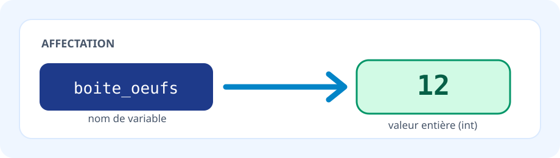

# 📚 OnlineNoteBookNSI — Cours Python interactifs

Une plateforme de cours de NSI à partir de fichiers **Markdown** : les élèves lisent les notions, modifient leurs programmes avec **Monaco Editor** et les exécutent dans le navigateur avec **Pyodide**.

## ✨ Fonctionnalités

- 📖 Cours Markdown avec sommaire automatique, encadrés colorés et sections déroulables.
- 🐍 Éditeurs Python interactifs, lecture seule pour les corrections (`python-static`).
- 💡 **Indices progressifs** : plusieurs panneaux `:::collapsible` sous chaque exercice.
- ✅ **Tests formatifs** : bouton « Vérifier » associé à certains exercices ; retour immédiatement visible.
- 💾 **Sauvegarde automatique locale** des cellules éditables, distincte pour chaque cours et exercice.
- 📂 **Import / Export du travail** par fichier JSON pour transférer ses réponses ou les rendre.
- 🎨 Illustrations SVG dans `assets/`, styles communs pour tous les chapitres.
- 📋 **Catalogue unique dans `config.json`** : 11 cours existants conservés.

> **Confidentialité et limites** : les réponses restent dans le `localStorage` de ce navigateur, sur cet appareil et sur la même origine (adresse Web). Elles ne sont pas synchronisées sur un serveur et peuvent disparaître si les données du navigateur sont effacées ou si l'enseignant change l'adresse du site. Utilisez régulièrement **Exporter** et conservez le fichier JSON.

## 🚀 Lancer le projet

Le site nécessite un serveur HTTP pour charger `config.json` et les fichiers Markdown (le mode `file://` ne convient pas).

```bash
python3 -m http.server 8000
```

Puis ouvrez `http://localhost:8000/`.

Une connexion est nécessaire au premier chargement des bibliothèques du navigateur (Pyodide, Monaco, Marked) depuis les CDN. Le code Python des élèves est exécuté dans leur navigateur ; il n'est **pas** envoyé à un serveur par la plateforme.

## 🗂️ Structure du dépôt

```text
OnlineNoteBookNSI/
├── index.html
├── app.js                  # Lecteur Markdown, éditeurs, exécution, tests et sauvegarde
├── styles.css              # Design général et composants pédagogiques
├── config.json             # UNIQUE catalogue des cours
├── assets/                 # Illustrations SVG (accessibles depuis le Markdown)
├── cours/
│   ├── TEMPLATE.md         # Modèle de chapitre réutilisable
│   ├── variables.md        # Chapitre complet avec exercices
│   └── ...                 # Autres cours existants
├── tests/check_content.py  # Validations du catalogue et des identifiants de cellules
└── .github/workflows/validate.yml
```

## ✍️ Créer un nouveau cours

1. Copiez `cours/TEMPLATE.md` vers `cours/mon-chapitre.md`.
2. Remplacez les objectifs, exemples, exercices, indices et corrections.
3. Ajoutez **uniquement** une entrée dans `config.json` :

```json
{
  "id": "mon-chapitre",
  "titre": "Mon chapitre",
  "icone": "🧭",
  "description": "Une phrase pour présenter le cours.",
  "fichier": "mon-chapitre.md",
  "niveau": "Première NSI",
  "duree_estimee": "1 h"
}
```

4. Vérifiez le format : `python3 tests/check_content.py` puis ouvrez le cours dans le navigateur.

### Bandeau de cours

```html
<div class="lesson-hero">
  <span class="eyebrow">PREMIÈRE NSI · CHAPITRE 1</span>
  <h1>📦 Les variables</h1>
  <p>Une brève introduction.</p>
  <div class="lesson-meta"><span>⏱ 1 h</span><span>🎯 Débutant</span></div>
</div>
```

### Encadrés Markdown

Les types reconnus sont `note`, `warning`, `attention`, `success`, `info` et `reminder` :

```text
:::note 🎯 Objectifs
- Objectif n°1
- Objectif n°2
:::

:::warning ⚠️ Attention
Une erreur fréquente.
:::
```

Ces blocs peuvent contenir des listes, du Markdown et des blocs de code. **N'imbriquez pas un bloc `:::` dans un autre.** Les anciens `:::details` restent pris en charge.

### Texte en couleur (syntaxe courte)

Dans tous les cours Markdown, on peut écrire :

```text
:g[Texte vert]        :r[Texte rouge]       :b[Texte bleu]
:o[Texte orange]      :v[Texte violet]      :s[Texte surligné]
```

Les noms longs en français sont également acceptés : `:vert[texte]`, `:rouge[texte]`, `:bleu[texte]`, `:orange[texte]`, `:violet[texte]` et `:surligne[texte]`.

**Exemple de cours :**

```markdown
La réponse est :g[correcte] mais :r[l'expression est incomplète].
:s[À retenir :] une variable permet de désigner une valeur.
:b[**Important :**] `=` effectue une affectation.
```

Cette syntaxe fonctionne aussi dans les tableaux, titres et indices repliables. On peut combiner la couleur avec `**gras**` ou `*italique*`.

La coloration n'est **pas appliquée aux blocs Python**, ni au code situé entre accents graves. Une marque courte doit tenir sur une même ligne et ne peut pas contenir de crochet fermant `]` dans son texte.

### Sections repliables pour les indices

```text
:::collapsible 💡 Indice 1 — Première piste
Une question ou un rappel.
:::

:::collapsible 🔍 Indice 2 — Une piste de code
Une indication plus précise.
:::

:::collapsible ✅ Correction
Une proposition de solution ; éventuellement un bloc python-static.
:::
```

### Code Python

Bloc modifiable et exécutable :

````markdown
```python
print('Bonjour')
```
````

Bloc modifiable avec **ID stable** (conseillé pour les exercices et leur sauvegarde) :

````markdown
```python:ex-01
resultat = 0  # À compléter
```
````

Correction en lecture seule :

````markdown
```python-static
resultat = 42
```
````

### Tests formatifs

Associez un bloc `python-test:<id>` à une cellule `python:<id>` du même cours. Le bouton **✓ Vérifier** apparaît automatiquement. Le code de l'élève est exécuté dans un espace de noms Python distinct, puis les tests utilisent `assert` et peuvent afficher une confirmation avec `print`.

````markdown
```python:ex-01
resultat = 0
```

```python-test:ex-01
assert resultat == 42, "Le résultat attendu est 42."
print("✅ Réussi !")
```
````

Les tests sont visibles dans les fichiers sources Markdown : **ils servent à l'autoévaluation formative, pas à la certification ni à la notation sécurisée**. Les tests ne garantissent pas la qualité d'un programme pour toutes les entrées.

### Illustrations

Stockez de préférence des images SVG légères dans `assets/`, puis insérez-les dans le cours :

```markdown

```

Le chemin est relatif à la page Web (`index.html`), et non au fichier Markdown `cours/...`.

## 💾 Sauvegarde, import et export

- Toute modification d'un éditeur est sauvegardée dans le stockage local du navigateur avec la clé `nsi-progress:v1:<id-cours>:<id-cellule>`.
- Lors du retour sur le même cours, le code précédent est automatiquement restauré.
- **Réinitialiser** restaure la version du cours et efface la sauvegarde de la cellule concernée.
- **Exporter** produit un fichier `nsi-<id-cours>-travail.json` contenant les cellules éditables.
- **Importer** recharge ce fichier dans le **même cours** ; seules les cellules aux identifiants correspondants sont restaurées.

Les éditeurs sans ID explicite restent compatibles, mais leur clé `auto-N` peut changer lorsque vous ajoutez ou retirez des blocs de code au chapitre. **Donnez un ID stable aux exercices** pour ne pas perdre leur correspondance après une mise à jour du cours.

## 🔧 Validation et dépannage

```bash
node --check app.js
python3 tests/check_content.py
```

La validation automatique vérifie le JSON, les fichiers des cours, les blocs `:::`, les identifiants Python et les liens SVG. Le navigateur doit être utilisé pour tester réellement l'éditeur, Pyodide et les rendus graphiques. GitHub Actions exécute les vérifications statiques sur les demandes de fusion.

Si une cellule n'exécute pas Python, vérifiez le chargement de Pyodide, la console du navigateur et les restrictions réseau sur les CDN. Certaines bibliothèques CPython natives (comme `tkinter`) ne fonctionnent pas dans Pyodide.

## 🎓 Pour les enseignants

- Introduisez une notion par un exemple court et une question d'observation.
- Prévoyez des exercices de difficulté progressive avec **deux indices** avant la correction.
- Placez les corrections dans des blocs repliables, avec `python-static`.
- Ajoutez un ou deux `assert` pertinents par exercice ; vérifiez qu'ils échouent sur le code initial et réussissent sur la correction.
- Faites exporter les fichiers JSON en fin de séance si les élèves doivent les remettre.

Ce projet repose sur Pyodide, Monaco Editor, Marked.js, JavaScript et CSS ; aucun compte externe n'est requis pour consulter ou exécuter les cours.
